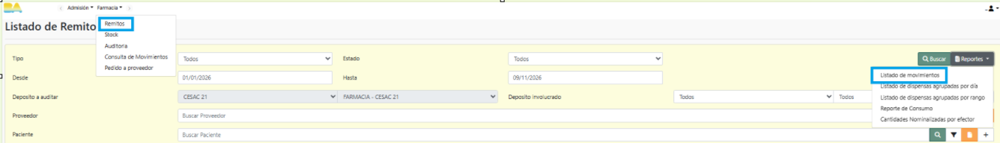

# Atención en taquilla · Farmacias CESAC

Página para contar los pacientes atendidos y las unidades entregadas en la taquilla de farmacia, a partir del reporte de remitos de SIGEHOS (módulo Medicación e insumos).

## Cómo se usa

1. En SIGEHOS, entrá a **Farmacia → Remitos** (Listado de Remitos).
2. Elegí las fechas **Desde** y **Hasta** y dejá el resto de los filtros en Todos.
3. Tocá **Reportes → Listado de movimientos**. Se descarga `rptEstRemitos.xlsx`.
4. Abrí la página y cargá el Excel. Los listados de dispensas agrupadas no sirven porque no traen el paciente.
5. Elegí el período y, si querés pacientes por hora, cargá el horario de atención de cada día.

El Excel se procesa en el navegador: no se sube a ningún servidor ni se guarda. No hace falta instalar nada.

## Qué muestra

- Pacientes atendidos (atenciones con entrega efectiva) y pacientes distintos.
- Unidades de medicamentos y de descartables entregadas.
- Entregas en relación con los pacientes: compara el inicio y el final del período (pacientes por día, unidades por día y unidades por atención) y explica si la variación de las entregas se debe a más o menos pacientes o a lo que recibe cada uno.
- Receta electrónica y receta en papel (columna Ind. interna: SI = electrónica, NO = papel): porcentaje de renglones de medicamentos, atenciones por tipo de receta, evolución mensual y medicamentos más dispensados con receta en papel.
- Medicamentos que dejaron de entregarse: los que se entregaban con regularidad (3 meses o más) y no se entregan hace más de 30 días, con la fecha de la última entrega.
- Detalle por mes y por día, con copia de la tabla para Excel.
- Atención por día de la semana y pacientes por hora.
- Medicamentos más entregados y atenciones por dispensador.
- **Exportar informe (PDF):** arma un informe con resumen en texto, cifras, gráficos y tablas, listo para enviar al jefe de farmacia. En la ventana de impresión, elegí "Guardar como PDF".
- **Descargar Excel:** un archivo con hojas de Resumen, Por mes, Por día, Día de la semana, Medicamentos, Discontinuados, Tipo de receta y Dispensadores.

## Criterios de conteo

- Solo remitos de tipo EGRESO, en estado CONFIRMADO, con paciente y cantidad mayor a cero.
- Los remitos devueltos quedan ANULADOS en SIGEHOS y no se cuentan.
- Una atención es un paciente que recibió al menos un producto en el día.
